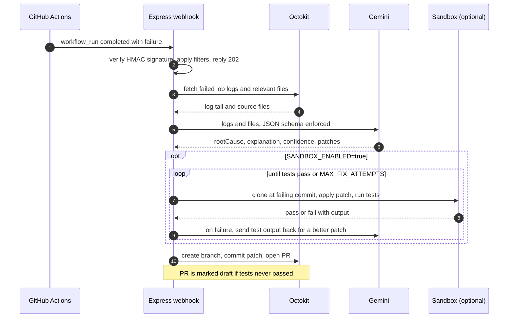

<div align="center">

# 🤖 CI/CD Triage Agent

### Your build breaks. An AI reads the logs, finds the bug, and opens the fix PR.


</div>

---

## ✨ What it does

Every red ❌ in GitHub Actions costs someone a context switch: open the run, scroll the logs, find the error, find the file, push a fix, wait again.

**CI/CD Triage Agent** does that loop for you. It listens for failed workflow runs, reads the logs and the relevant source files, asks **Google Gemini** for the root cause and a patch, optionally **proves the patch works** by running your tests in a sandbox, and then opens a **Pull Request** with the fix and a plain-English explanation.

You review and merge. You never get a PR you can't read, and it never pushes to your default branch.

## 🧭 How it works



1. **Catch** the `workflow_run` webhook. The signature is verified and the server answers in milliseconds so GitHub never times out.
2. **Gather evidence.** It pulls the tail of each failed job's log, finds the files named in the stack traces, and also grabs sibling source files, because a failing test's trace usually names the test, not the code under test.
3. **Diagnose.** Gemini returns structured JSON: root cause, explanation, confidence, and the *complete* new content of each changed file.
4. **Validate** (optional). The patch is applied to a fresh clone at the failing commit and your test command is run. If it still fails, the output is fed back to Gemini for another attempt.
5. **Open a PR** from `triage-agent/fix-run-<id>` with the root cause, what changed, the model's confidence and the sandbox result.

## 🚀 Features

| | |
|---|---|
| 🔐 **Signed webhooks** | HMAC-SHA256 verification with constant-time comparison |
| 🧠 **Structured LLM output** | Gemini is forced to answer in a JSON schema, so there is no fragile text parsing |
| 🔎 **Smart file discovery** | Extracts paths from logs, normalizes CI runner paths, and pulls sibling files for context |
| 🧪 **Sandbox validation** | Optionally runs your tests on the patch before any PR is opened |
| 🔁 **Self-correcting loop** | Failed validation output is fed back to Gemini for another try |
| 📝 **Honest PRs** | Unverified fixes open as **draft** PRs and say so |
| 🛡️ **Safe by default** | `DRY_RUN=true` out of the box: it logs the patch and touches nothing |
| ♻️ **Resilient** | Exponential backoff on Gemini 429/5xx errors, plus an optional fallback model |

## ⚡ Quick start

**Prerequisites:** Node.js 20.6+, a GitHub account, a [Gemini API key](https://aistudio.google.com/apikey), and [ngrok](https://ngrok.com) (or any tunnel) for local webhook testing.

```bash
git clone https://github.com/AKASH1904-PANDEY/cicd-triage-agent.git
cd cicd-triage-agent
npm install
cp .env.example .env      # Windows: copy .env.example .env
```

Fill in `.env` (see [Configuration](#-configuration)), then:

```bash
npm run dev
```

You should see:

```
cicd-triage-agent listening on :3000 (DRY_RUN=true)
```

### Connect GitHub

1. Start a tunnel: `ngrok http 3000`
2. In your test repo, go to **Settings → Webhooks → Add webhook**:
   - **Payload URL:** `https://<your-tunnel>/webhook`
   - **Content type:** `application/json`
   - **Secret:** the same value as `WEBHOOK_SECRET`
   - **Events:** *Let me select individual events* → only **Workflow runs**
3. Open **Recent Deliveries**. The ping should show a green tick with the response `pong`.

### Create a GitHub token

Use a **fine-grained personal access token** limited to the repos you want to watch:

| Permission | Access |
|---|---|
| Contents | Read and write |
| Pull requests | Read and write |
| Actions | Read-only |
| Metadata | Read-only |

Add *Workflows: Read and write* only if you want the agent to be allowed to patch files in `.github/workflows/`.

## 🧪 Try it on a deliberately broken repo

Push a tiny project whose test fails on purpose, for example a `sum(a, b)` that returns `a - b`, with a test expecting `sum(2, 3) === 5` and a workflow that runs `npm test`. When the run fails, the server log looks like this (illustrative):

```
[you/repo run 123] fetching logs
[you/repo run 123] fetching relevant files
[you/repo run 123] attempt 1/2: asking Gemini (gemini-3.8-flash)
[you/repo run 123] root cause: sum() subtracts instead of adding
[you/repo run 123] fixable=true confidence=high
[you/repo run 123] DRY_RUN=true, would patch: ci-demo/sum.js
```

Set `DRY_RUN=false` once the logged patches look right, and the agent opens a real PR.

## ⚙️ Configuration

| Variable | Default | Description |
|---|---|---|
| `PORT` | `3000` | Server port |
| `GEMINI_API_KEY` | required | Key from Google AI Studio |
| `GITHUB_TOKEN` | required | Fine-grained token (see above) |
| `WEBHOOK_SECRET` | required | Shared secret for webhook signatures |
| `GEMINI_MODEL` | `gemini-3.8-flash` | Model used for triage |
| `GEMINI_MAX_RETRIES` | `4` | Retries on 429/5xx with exponential backoff |
| `GEMINI_FALLBACK_MODEL` | *(empty)* | Optional second model if the first stays overloaded |
| `DRY_RUN` | `true` | `true` = log the patch only, open no PR |
| `SANDBOX_ENABLED` | `false` | Validate patches by running tests before opening a PR |
| `SANDBOX_COMMAND` | `npm ci && npm test` | Command run inside the sandbox |
| `SANDBOX_TIMEOUT_MS` | `600000` | Sandbox timeout (10 minutes) |
| `MAX_FIX_ATTEMPTS` | `2` | Gemini attempts when sandbox validation fails |
| `ALLOWED_REPOS` | *(empty = all)* | Comma-separated `owner/repo` allowlist |

**Recommended rollout:** start with `DRY_RUN=true`, then enable `SANDBOX_ENABLED=true`, and only then set `DRY_RUN=false`.

## 🛡️ Safety guardrails

- **Webhook authentication.** Unsigned or wrongly signed requests get a 401.
- **Loop protection.** Runs on `triage-agent/*` branches are ignored, so the agent never tries to fix its own fix.
- **No forks.** Runs from forked repositories are ignored.
- **Allowlist.** `ALLOWED_REPOS` restricts which repos the agent will act on.
- **Dedupe.** Redelivered webhooks for a run already in progress are dropped.
- **Patch whitelist.** Only files the model saw in full can be patched, so truncated files are never overwritten. Path traversal is blocked.
- **No-op filter.** Patches identical to the original file are discarded.
- **Secret scrubbing.** API keys are stripped from the sandbox environment and redacted from git errors.
- **Human in the loop.** The agent only opens PRs. It never merges and never pushes to your default branch.

> ⚠️ **The sandbox runs your repo's own scripts on your machine.** Use it only on repositories you trust. For anything untrusted, run the agent inside Docker.

## 🗂️ Project structure

```
cicd-triage-agent/
├── .env.example          # copy to .env and fill in
├── package.json
├── README.md
└── src/
    ├── index.js          # Express server, webhook verification, pipeline orchestration
    ├── githubService.js  # Octokit wrapper: logs, file discovery, branch + PR creation
    ├── geminiService.js  # Gemini integration: prompt, JSON schema, retry/fallback
    └── sandbox.js        # Clone at failing commit, apply patch, run tests
```

## 🔧 Troubleshooting

| Symptom | Likely cause |
|---|---|
| Webhook delivery shows **401** | `WEBHOOK_SECRET` mismatch, or content type is not `application/json` |
| Delivery fails or times out | Tunnel is not running, or its URL changed |
| Delivery is OK but nothing is logged | Run did not fail, repo not in `ALLOWED_REPOS`, branch starts with `triage-agent/`, or run came from a fork |
| **403/404** fetching logs | Token lacks *Actions: read* or access to that repo |
| Gemini **404** | Model name is wrong or no longer available to your key |
| Gemini **503 / 429** | Model is overloaded or rate-limited. The agent retries automatically |
| PR creation **403** | Token lacks *Contents* or *Pull requests* write access |
| `node: bad option: --env-file` | Node.js is older than 20.6 |

## 🗺️ Roadmap

- [ ] Run the sandbox in Docker for untrusted repos
- [ ] Post the diagnosis as a PR comment when no patch is possible
- [ ] Support multi-job and matrix workflow failures more precisely
- [ ] Pull in dependency files and lockfile context for install-time failures
- [ ] Persist run history and basic stats
- [ ] GitHub App authentication instead of a personal access token

## ⚠️ Limitations

This is an early (`v0.1`) project. It works best on small, well-scoped failures such as broken tests, type errors and lint errors. Flaky tests, infrastructure problems, missing secrets and large multi-file refactors are outside its reach, and in those cases the agent reports the root cause without producing a patch. **Always review the PR before merging.** An LLM can be confidently wrong.

## 🧰 Tech stack

Node.js · Express · `@google/genai` · `@octokit/rest` · ngrok (local dev)

---

<div align="center">

Built by **[Akash Pandey](https://github.com/AKASH1904-PANDEY)**

</div>